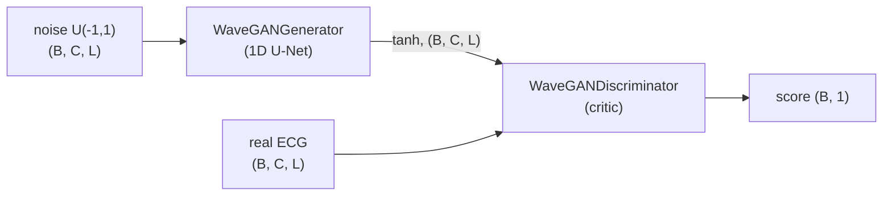

# Pulse2Pulse GAN

Pulse2Pulse is a WaveGAN-style generative adversarial network for ECG synthesis, trained with
the **WGAN-GP** objective (Wasserstein loss with gradient penalty). The generator is a 1D
U-Net that turns a uniform-noise tensor *with the same shape as an ECG* into an ECG; the
discriminator (critic) is a deep strided 1D CNN with WaveGAN phase shuffling.

!!! tip "Visual guide"
    For animated diagrams of the input, architecture, output and loss, see the
    [visual guide](../visual/pulse2pulse.md).

By default it models **8 leads × 5000 samples** (10 s at 500 Hz): leads I, II, III, aVR, aVL,
aVF, V1, V2, the first 8 channels of the 12-lead MIMIC-IV-ECG records.

For training and sample generation, see [Pulse2Pulse Training](../training/pulse2pulse_training.md).

## Where the code lives

`src/ecgen/families/gan/pulse2pulse.py` (`ecgen.families.gan.pulse2pulse`, also exported from
`ecgen.families.gan`), registered with the training runner as **`pulse2pulse`**. The old import
paths `models.gan.pulse2pulse` and `ecgen.models.pulse2pulse` are re-export shims kept for one
release; `scripts/generate/generate_pulse2pulse.py` still imports through `models.gan.pulse2pulse`.

```python
from ecgen.families.gan import Pulse2PulseGAN, Pulse2PulseConfig
```

The public names in the module are:

- `Pulse2PulseConfig`: dataclass with the hyperparameters
- `Pulse2PulseGAN`: the `LightningModule` (generator + discriminator + WGAN-GP training loop)
- `WaveGANGenerator`, `WaveGANDiscriminator`: the plain `nn.Module`s
- `PhaseShuffle`, `Transpose1dLayer`, `Transpose1dLayerMultiInput`: building blocks
- `calc_gradient_penalty(netD, real_data, fake_data, lmbda)`: the WGAN-GP penalty

## Architecture



### Generator: `WaveGANGenerator`

```python
WaveGANGenerator(
    model_size: int = 50,
    num_channels: int = 8,
    post_proc_filt_len: int = 0,
    verbose: bool = False,
    upsample: bool = True,
)
```

The input is noise of shape `(B, num_channels, seq_length)`, not a latent vector. The
encoder path has six `Conv1d` layers (kernel 25, `padding=12`, LeakyReLU). The decoder path
upsamples with `nn.Upsample` followed by a `Conv1d` (kernel 25), and concatenates U-Net skip
connections from the encoder. The output goes through `tanh`, so generated values are in
`[-1, 1]`.

Shapes for the defaults (`model_size=50`, `num_channels=8`, input length 5000):

| Encoder layer | Channels | Stride | Output shape |
|---------------|----------|--------|--------------|
| `conv_1` | 8 → 10 (`ms//5`) | 2 | `(B, 10, 2500)` |
| `conv_2` | 10 → 25 (`ms//2`) | 5 | `(B, 25, 500)` |
| `conv_3` | 25 → 50 (`ms`) | 2 | `(B, 50, 250)` |
| `conv_4` | 50 → 150 (`3·ms`) | 5 | `(B, 150, 50)` |
| `conv_5` | 150 → 250 (`5·ms`) | 5 | `(B, 250, 10)` |
| `conv_6` | 250 → 250 (`5·ms`) | 5 | `(B, 250, 2)` |

| Decoder layer | Skip input | Upsample | Output channels |
|---------------|------------|----------|-----------------|
| `deconv_1` | — | ×5 | `5·ms` |
| `deconv_2` | `conv_5` | ×5 | `3·ms` |
| `deconv_3` | `conv_4` | ×5 | `ms` |
| `deconv_5` | `conv_3` | ×2 | `ms//2` |
| `deconv_6` | `conv_2` | ×5 | `ms//5` |
| `deconv_7` | — | ×2 | `num_channels` (then `tanh`) |

With `upsample=False`, the layers use `ConvTranspose1d` (stride 4) instead. Setting
`post_proc_filt_len > 0` adds a final `Conv1d(num_channels, num_channels, post_proc_filt_len)`.
`Pulse2PulseGAN` never passes these two arguments, so it always uses the defaults
(`upsample=True`, no post-processing filter).

!!! warning "Sequence length constraint"
    The encoder downsamples by `2·5·2·5·5·5 = 2500`, so `seq_length` must be a multiple of
    2500: 2500, 5000 and 10000 work, but 4000 fails with a shape mismatch at the skip
    concatenation.

With the defaults, the generator has about **10.5 M** parameters.

### Discriminator: `WaveGANDiscriminator`

```python
WaveGANDiscriminator(
    model_size: int = 64,
    num_channels: int = 8,
    shift_factor: int = 2,
    alpha: float = 0.2,
    verbose: bool = False,
)
```

It has seven `Conv1d` layers (kernel 25, `padding=11`) with LeakyReLU (`negative_slope=alpha`).
A `PhaseShuffle(shift_factor)` follows each of the first six layers.

| Layer | Channels (×`model_size`) | Stride | Output for L=5000, ms=50 |
|-------|--------------------------|--------|--------------------------|
| `conv1` | C → 1 | 2 | `(B, 50, 2499)` |
| `conv2` | 1 → 2 | 2 | `(B, 100, 1249)` |
| `conv3` | 2 → 5 | 2 | `(B, 250, 624)` |
| `conv4` | 5 → 10 | 2 | `(B, 500, 311)` |
| `conv5` | 10 → 20 | 4 | `(B, 1000, 78)` |
| `conv6` | 20 → 25 | 4 | `(B, 1250, 19)` |
| `conv7` | 25 → 100 | 4 | `(B, 5000, 5)` |

The output is flattened and passed to a final `nn.Linear(flat_dim, 1)` that is **created
lazily** on the first forward pass (`_ensure_fc`) to match the sequence length. The critic
returns an unbounded score of shape `(B, 1)`, with no sigmoid.

`Pulse2PulseGAN` builds the discriminator with `model_size=config.model_size` (50 by default),
not with the class default of 64. At `model_size=50` it has about **204 M** parameters. Most of
them are in `conv7`, so the critic is roughly 20× larger than the generator.

**PhaseShuffle** shifts each sample in the batch by a random integer `k ∈ [-shift_factor, shift_factor]`
along time and fills the gap with reflection padding. This stops the critic from relying on
exact sample phase.

## Configuration: `Pulse2PulseConfig`

```python
@dataclass
class Pulse2PulseConfig:
    model_size: int = 50
    num_channels: int = 8
    seq_length: int = 5000
    lr: float = 1e-4
    b1: float = 0.5
    b2: float = 0.9
    lmbda: float = 10.0
    n_critic: int = 5
```

| Field | Default | Meaning |
|-------|---------|---------|
| `model_size` | `50` | Width multiplier for both generator and discriminator |
| `num_channels` | `8` | Number of ECG leads (input and output channels) |
| `seq_length` | `5000` | Samples per ECG; also the noise length (must be a multiple of 2500) |
| `lr` | `1e-4` | Adam learning rate (same for G and D) |
| `b1`, `b2` | `0.5`, `0.9` | Adam betas (same for G and D) |
| `lmbda` | `10.0` | Gradient-penalty weight λ |
| `n_critic` | `5` | A generator update happens every `n_critic` batches |

`Pulse2PulseGAN(config)` accepts either a `Pulse2PulseConfig` or a plain `dict` with these keys.

!!! note "`configs/model/gan/pulse2pulse.yaml` is not used"
    That fragment (`latent_dim`, `base_channels`, `lr_g`, `lr_d`, `b2: 0.999`, ...) does not
    match `Pulse2PulseConfig`, and nothing reads it. The values that take effect are the
    `Pulse2PulseConfig` defaults overridden by `model.params` in
    `configs/experiments/pulse2pulse_mimic.yaml`. See
    [Pulse2Pulse Training](../training/pulse2pulse_training.md).

## Training objective (WGAN-GP)

`Pulse2PulseGAN` sets `automatic_optimization = False` and runs a manual loop in
`training_step`. It reads the real ECGs with `get_signal(batch)` (an `ECGBatch`'s `signal`, or the
legacy `batch["ecg_signals"]`), of shape `(B, num_channels, seq_length)`.

For **every batch**, it updates the critic:

$$
\mathcal{L}_D = \mathbb{E}[D(\tilde x)] - \mathbb{E}[D(x)] + \lambda\,\mathbb{E}_{\hat x}\big[(\lVert\nabla_{\hat x} D(\hat x)\rVert_2 - 1)^2\big]
$$

Here $\tilde x = G(z)$ with $z \sim U(-1,1)$ (detached), and $\hat x$ is a random per-sample
interpolation between real and fake (`calc_gradient_penalty`).

It updates the **generator** only when `(batch_idx + 1) % n_critic == 0`, using
$\mathcal{L}_G = -\mathbb{E}[D(G(z))]$ with fresh noise.

Both optimizers are `torch.optim.Adam(lr=config.lr, betas=(config.b1, config.b2))`.
`configure_optimizers` returns `[opt_g, opt_d], []`, with no LR schedulers.

### Logged metrics

| Key | When | Meaning |
|-----|------|---------|
| `train/d_loss` | step + epoch (prog bar) | Critic loss incl. GP |
| `train/d_wasserstein` | step + epoch | `D(real) - D(fake)`, the Wasserstein estimate |
| `train/g_loss` | step + epoch (prog bar) | `-D(G(z))`; logged as `0.0` on steps without a G update |
| `val/d_wasserstein` | epoch (prog bar) | Wasserstein estimate on validation batches |
| `val_loss` | epoch (prog bar) | `-val/d_wasserstein` |

`configs/experiments/pulse2pulse_mimic.yaml` checkpoints on `val/d_wasserstein` with `mode: max`.

`validation_step` also stores the first real and generated sample of batch 0 in
`_val_real_sample` / `_val_fake_sample`. `ECGVisualizationCallback` reads these
(see [Callbacks](../training/callbacks.md)).

### Loss helpers in `src/ecgen/families/gan/losses.py`

The Lightning module computes its losses inline and does **not** import this module. The
helpers are equivalent, standalone functions:

| Function | Returns |
|----------|---------|
| `wgan_discriminator_loss(d_real, d_fake, gp)` | `d_fake - d_real + gp` |
| `wgan_generator_loss(d_fake)` | `-d_fake` |
| `adversarial_loss(pred, target_is_real: bool)` | BCE-with-logits against all-ones / all-zeros targets |
| `least_squares_discriminator_loss(d_real, d_fake)` | `0.5 * (mean((d_real-1)^2) + mean(d_fake^2))` |
| `least_squares_generator_loss(d_fake)` | `0.5 * mean((d_fake-1)^2)` |

`wgan_*` do not reduce, so pass already-averaged critic outputs. The WGAN-GP penalty is also
available as `training.metrics.clinical.gradient_penalty_loss(discriminator, real_data,
fake_data, lmbda=10.0)`, and the Wasserstein estimate as
`training.metrics.clinical.wasserstein_distance(d_real, d_fake)`
(see [Evaluation Metrics](../evaluation/metrics.md#training-time-metrics-trainingmetrics)).

## Sampling

```python
import torch
from ecgen.families.gan.pulse2pulse import Pulse2PulseGAN, Pulse2PulseConfig

model = Pulse2PulseGAN(Pulse2PulseConfig())
samples = model.generate_samples(n_samples=16)   # (16, 8, 5000), values in [-1, 1]

# or, equivalently, with your own noise:
z = torch.empty(4, 8, 5000).uniform_(-1, 1)
with torch.no_grad():
    ecg = model(z)                                # forward() == netG(noise)
```

`generate_samples(n_samples=16)` runs under `@torch.no_grad()`, switches `netG` to eval mode,
and samples noise on the generator's device.

### Loading a checkpoint

A plain `load_from_checkpoint` restores the model:

```python
from ecgen.families.gan.pulse2pulse import Pulse2PulseGAN

model = Pulse2PulseGAN.load_from_checkpoint(
    "runs/pulse2pulse_mimic/seed_42/checkpoints/last.ckpt",
    map_location="cpu",
)
samples = model.generate_samples(16)
```

The constructor accepts either `config=` or the flat `Pulse2PulseConfig` fields that
`save_hyperparameters(config.__dict__)` stores in the checkpoint, so no config needs to be passed
(an explicit `config=Pulse2PulseConfig(...)` still works). The checkpoint also holds
`netD.fc1.*` weights for the lazily created linear layer; `on_load_checkpoint` creates `fc1` at
the saved size before the state dict is loaded, so strict loading works and `strict=False` is
not needed. `scripts/generate/generate_pulse2pulse.py` uses this call.

## Conditional Pulse2Pulse

With `conditioning` in the config, `Pulse2PulseGAN` is a conditional WGAN-GP
(see [Conditioning](../training/conditioning.md#conditional-families)):
global conditions drive FiLM layers in the generator's decoder and a projection
head in the critic; a dense `masked_signal` condition is concatenated to the
generator's noise and to the critic's input (paired critic). `l1_weight` adds a
pix2pix-style L1 term on the unobserved part, which makes it a lead-reconstruction
model (`configs/experiments/pulse2pulse_lead_reconstruction.yaml`).

| Field | Default | Meaning |
|---|---|---|
| `conditioning` | `None` | Conditioning config (`ecgen.conditioning`) |
| `l1_weight` | `0.0` | Weight of the L1 term to the real ECG |
| `l1_on` | `"unobserved"` | L1 on the unobserved part (needs `data.masks`) or on `"all"` |
| `output_scale` | `1.0` | Multiplies the generator's `tanh` output |

## Known issues

- **Fixed: the critic's final linear layer was never trained.** `fc1` used to be created
  on the first forward pass, after `configure_optimizers()` had built `opt_d`, so it stayed at
  its random initialisation. `Pulse2PulseGAN` now builds `fc1` in `__init__` (from
  `seq_length`), so it is in the critic's optimizer. Models trained before this fix had a
  fixed random `fc1`; their checkpoints still load.
- **Output range vs. data scaling.** The generator ends in `tanh` (range `[-1, 1]`), but
  `MIMICIVECG` (with the default `scale: zscore`) z-score normalises each record (zero mean,
  unit std), so real ECGs regularly exceed ±1. Set `output_scale` (e.g. `8.0` for z-scored
  data) to stretch the generator's range, or scale the data into ±1 (e.g. `scale: 5` = mV / 5).
- **`n_critic` is based on `batch_idx`.** If an epoch has fewer than `n_critic` batches
  (for example, with a tiny `max_samples`), the generator is never updated. The epoch mean of
  `train/g_loss` includes the logged zeros.

## See also

- [Pulse2Pulse Training](../training/pulse2pulse_training.md): training config and generate script
- [Architecture Overview](architecture.md)
- [Evaluation Metrics](../evaluation/metrics.md)
- API reference: [Models](../api/models.md), [Training](../api/training.md)
