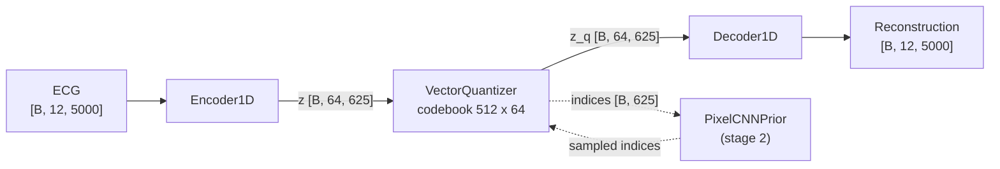

# VQ-VAE + PixelCNN Prior

ECGEN's VQ-VAE is a two-stage generative model for 12-lead ECGs:

!!! tip "Visual guide"
    For animated diagrams of the input, architecture, output and loss, see the
    [visual guide](../visual/vqvae.md).

1. **Stage 1 – VQ-VAE** (`VQVAELightning`): a 1D convolutional autoencoder whose
   latent is snapped to the nearest entry of a learned codebook, so each ECG becomes a
   sequence of discrete code indices.
2. **Stage 2 – PixelCNN prior** (`PriorLightning`): an autoregressive model over those
   code indices, trained while the stage-1 model stays frozen.

To generate, the prior samples a sequence of code indices and the VQ-VAE decoder turns
it into an ECG.

All classes live in `models/vqvae/` and are exported from `models.vqvae`:

```python
from models.vqvae import (
    VQVAEConfig, PriorConfig,            # dataclass configs
    VQVAE1D, VectorQuantizer,            # plain nn.Modules (stage 1)
    PixelCNNPrior, CausalGatedBlock,     # plain nn.Modules (stage 2)
    VQVAELightning, PriorLightning,      # LightningModule wrappers
)
```

For training instructions, see [VQ-VAE Training](../training/vqvae_training.md). For the
generated API reference, see [Models API](../api/models.md).

## Architecture



### Encoder and decoder

`VQVAE1D` reuses the shared `Encoder1D` / `Decoder1D` from `models/components/`, the same
blocks that the [VAE](vae.md) uses:

- **`ResidualBlock1D`** (`models/components/blocks.py`): two `Conv1d(k=3)` → `GroupNorm(8)` → SiLU
  layers with a residual shortcut (a 1×1 conv when the channel count changes).
- **`Encoder1D`**: `Conv1d(k=7)` stem, then for each entry in `channel_multipliers`, `num_res_blocks`
  residual blocks at `base_channels * mult` channels. A stride-2 `Conv1d(k=4)` follows every
  stage except the last. Then two mid residual blocks, GroupNorm, SiLU, and a `Conv1d` to
  `2 * latent_channels`, which is split into `(mean, logvar)`.
- **`Decoder1D`**: the mirror image. It uses `ConvTranspose1d(k=4, stride=2)` upsampling and a
  `Conv1d(k=7)` output to `in_channels` leads.

!!! note "Only the first half of the encoder output is used"
    `Encoder1D` was written for the VAE and returns `(mean, logvar)`. `VQVAE1D.encode()` keeps
    only `mean` as the continuous latent `z` and discards `logvar`. It returns `(z, z)` so the
    API matches the VAE's.

### Vector quantizer

`VectorQuantizer(num_embeddings, embedding_dim, commitment_cost)` (`models/vqvae/vector_quantizer.py`)
works as follows:

- It holds an `nn.Embedding(num_embeddings, embedding_dim)` codebook, initialised uniformly in
  `[-1/K, 1/K]`.
- It finds the nearest codebook vector (L2 distance) for every latent time step.
- It computes `vq_loss = mse(sg[z_q], z) + commitment_cost * mse(z_q, sg[z])`, where `sg` is
  stop-gradient. In this formula the first term updates the encoder and the second term updates
  the codebook. The original VQ-VAE paper does the opposite: it puts β on the encoder
  (commitment) term. Here β = `commitment_cost` scales the codebook term, even though the code
  comments call it the commitment loss.
- It passes gradients to the encoder with the straight-through estimator: `z_q = z + (z_q - z).detach()`.
- `forward(z)` returns `(vq_loss, quantized [B, C, L], indices [B, L])`.
- `get_codebook_entry(indices)` maps `[B, L]` indices back to `[B, C, L]` vectors.

`embedding_dim` is set to `latent_channels`.

### PixelCNN prior

`PixelCNNPrior(num_embeddings=512, hidden_dim=128, num_layers=10, kernel_size=2, dilation_cycle=10)`
(`models/vqvae/pixelcnn_prior.py`) is a WaveNet-style stack of causal dilated convolutions. It
has these parts:

- `nn.Embedding(num_embeddings, hidden_dim)` turns code indices into vectors.
- The embedded sequence is shifted right by one position (zeros at `t = 0`), so position `t`
  only sees codes `< t`.
- `num_layers` `CausalGatedBlock(hidden_dim, kernel_size, dilation)` blocks. Block `i` uses
  dilation `2 ** (i % dilation_cycle)`, so with the defaults the dilations are 1, 2, 4, …, 512.
  Each block left-pads its input by `(kernel_size - 1) * dilation`, applies a causal dilated
  conv with the gated activation `tanh(W_f * x) * sigmoid(W_g * x)`, and produces a 1×1
  residual output (added to the block input) and a 1×1 skip output.
- The skip outputs of all blocks are summed and passed through a head: ReLU, 1×1 `Conv1d`,
  ReLU, 1×1 `Conv1d` to `num_embeddings` logits.
- `forward(indices [B, L])` returns `logits [B, num_embeddings, L]`. The logit at position `t`
  predicts code `t` from codes `< t`.
- `receptive_field` returns `1 + sum((kernel_size - 1) * d)` over the block dilations: **1024**
  codes with the defaults, which covers all 625 codes of a 5000-sample ECG.
- `sample(batch_size=1, latent_length=625, temperature=1.0, device="cuda")` fills a zero tensor
  one position at a time, drawing each code from `softmax(logits / temperature)`. Each step only
  feeds the last `receptive_field` codes to the network (`indices[:, start:i+1]`), which gives
  the same result as feeding the full context.

Training and sampling use the logits the same way: logit `t` is trained to predict code `t`
(see `PriorLightning.compute_loss` below), and sampling draws code `t` from logit `t`.

## Shapes and downsampling factor

The encoder has `len(channel_multipliers)` stages, but only the first `len - 1` stages
downsample. Each stride-2 conv halves the length, so:

```
downsampling factor = 2 ** (len(channel_multipliers) - 1)
```

With the default `(1, 2, 4, 4)` the factor is **8**, which gives these shapes:

| Tensor | Shape (defaults, `seq_length=5000`) |
|---|---|
| Input ECG | `[B, 12, 5000]` |
| Continuous latent `z` | `[B, 64, 625]` |
| Quantized latent `z_q` | `[B, 64, 625]` |
| Code indices | `[B, 625]` (values in `[0, 512)`) |
| Prior logits | `[B, 512, 625]` |
| Reconstruction | `[B, 12, 5000]` |

`seq_length` should be divisible by the factor, or the reconstruction will be shorter than
the input.

`VQVAELightning.downsample_factor` returns this factor, and
`VQVAELightning.latent_length(seq_length)` returns `seq_length // factor`. It raises
`ValueError` if `seq_length` is not a multiple of the factor. `VQVAELightning.sample()` and
`PriorLightning.sample()` both use it, so samples always have the requested length.

With the default config, the stage-1 model has about 6.38 M parameters and the PixelCNN prior
has about 1.14 M (1,136,256).

## Configuration

Both configs are dataclasses in `models/vqvae/config.py`. The Lightning wrappers accept the
dataclass, a plain `dict` (converted with `Config(**dict)`), or the fields as flat keyword
arguments (`VQVAELightning(num_embeddings=256)`), which is what `load_from_checkpoint` uses.

### `VQVAEConfig`

| Field | Type | Default | Meaning |
|---|---|---|---|
| `in_channels` | `int` | `12` | Number of ECG leads (input and output channels) |
| `base_channels` | `int` | `64` | Channel width of the first encoder stage |
| `latent_channels` | `int` | `64` | Latent channels, which is also the codebook embedding dim |
| `channel_multipliers` | `tuple[int, ...]` | `(1, 2, 4, 4)` | Per-stage width multipliers. `len - 1` sets the number of ×2 downsamplings |
| `num_res_blocks` | `int` | `2` | Residual blocks per stage |
| `num_embeddings` | `int` | `512` | Codebook size `K` |
| `commitment_cost` | `float` | `0.25` | Weight β in the VQ loss |
| `lr` | `float` | `1e-4` | Adam learning rate |
| `b1` | `float` | `0.9` | Adam β1 |
| `b2` | `float` | `0.999` | Adam β2 |

### `PriorConfig`

| Field | Type | Default | Meaning |
|---|---|---|---|
| `num_embeddings` | `int` | `512` | Vocabulary size. **Must equal the VQ-VAE's `num_embeddings`** |
| `hidden_dim` | `int` | `128` | Embedding and conv width of the PixelCNN |
| `num_layers` | `int` | `10` | Number of `CausalGatedBlock` layers |
| `kernel_size` | `int` | `2` | Kernel size of the causal convolutions |
| `dilation_cycle` | `int` | `10` | Layer `i` uses dilation `2 ** (i % dilation_cycle)`. The defaults give dilations 1 … 512 and a receptive field of 1024 codes |
| `lr` | `float` | `1e-3` | Adam learning rate |
| `b1` | `float` | `0.9` | Adam β1 |
| `b2` | `float` | `0.999` | Adam β2 |
| `vqvae_checkpoint` | `str` | `""` | Path to the stage-1 checkpoint. If non-empty (and `vqvae_config` is unset), it is loaded and frozen in `__init__` |
| `vqvae_config` | `dict \| None` | `None` | The VQ-VAE's config fields. Filled in automatically when `vqvae_checkpoint` is loaded, so prior checkpoints can be restored without the stage-1 file. If set, `__init__` builds the VQ-VAE from it instead of reading `vqvae_checkpoint` |

`configs/model/vqvae/vqvae_1d_base.yaml` and `configs/model/vqvae/prior_base.yaml` list the
same defaults as YAML fragments. See [VQ-VAE Training](../training/vqvae_training.md#configuration)
for how the experiment YAMLs are wired.

## Losses

Both losses live in `training/losses/vqvae_losses.py`.

| Function | Signature | Computes |
|---|---|---|
| `vqvae_loss` | `(recon, x, vq_loss) -> (total, recon_loss, vq_loss)` | `recon_loss = mse(recon, x)` (mean). `total = recon_loss + vq_loss`. There is no KL term |
| `prior_loss` | `(logits [B, K, L], targets [B, L]) -> loss` | Mean cross-entropy over all positions |

`vq_loss` is the codebook + commitment loss returned by `VectorQuantizer`. The total loss has
no extra weight on it.

## Lightning wrappers

### `VQVAELightning` (stage 1)

`models/vqvae/vqvae_lightning.py`. Constructed as `VQVAELightning(config)` and wraps a
`VQVAE1D` in `self.vqvae`.

| Method | Description |
|---|---|
| `forward(x)` | Returns `(recon, vq_loss, indices)` |
| `training_step` / `validation_step` | Accept a `(ecg, features)` tuple (the MIMIC dataset format) or a dict with key `"ecg_signals"` |
| `reconstruct(x)` | `no_grad`. Returns the reconstruction `[B, C, L]` |
| `encode_to_indices(x)` | `no_grad`. Returns code indices `[B, L_latent]`. The prior uses this |
| `decode_from_indices(indices)` | `no_grad`. Returns an ECG `[B, C, L_latent * factor]` |
| `sample(n_samples=16, seq_length=5000)` | Decodes **uniformly random** code indices. Useful only as a sanity check. Use the prior for real generation |
| `configure_optimizers()` | Single Adam optimizer (`lr`, `betas=(b1, b2)`) |

`reconstruct`, `encode_to_indices`, `decode_from_indices` and `sample` put the inner model in
`eval()` mode.

Logged metrics:

| Key | When |
|---|---|
| `train/total_loss`, `train/recon_loss`, `train/vq_loss` | Every step and epoch |
| `train/unique_codes`, `train/codebook_usage` | Every 100th training batch. `codebook_usage = unique_codes / num_embeddings` |
| `val/total_loss`, `val/recon_loss`, `val/vq_loss` | Per epoch |
| `val_loss` | Per epoch (same as `val/total_loss`). Monitored by checkpointing and early stopping |
| `val/unique_codes`, `val/codebook_usage` | Per epoch |

!!! tip "Watch codebook usage"
    A low `codebook_usage` means codebook collapse: only a few codes are ever selected. That
    limits reconstruction quality and makes the prior's job trivial.

### `PriorLightning` (stage 2)

`models/vqvae/prior_lightning.py`. Constructed as `PriorLightning(config)` and wraps a
`PixelCNNPrior` in `self.prior`. The frozen VQ-VAE in `self.vqvae` is set up in one of two ways:

- If `config.vqvae_config` is set (the case when restoring a prior checkpoint), `__init__` builds
  an untrained `VQVAELightning(config.vqvae_config)`, calls `.eval()` and `.freeze()`, and the
  weights are then filled in from the prior checkpoint's own `state_dict`.
- Otherwise, if `config.vqvae_checkpoint` is non-empty, `__init__` loads it with
  `VQVAELightning.load_from_checkpoint(path, map_location="cpu")`, calls `.eval()` and
  `.freeze()`, and records the VQ-VAE's config as `vqvae_config` in the prior's hyperparameters.
  It raises `FileNotFoundError` if the path does not exist.

| Method | Description |
|---|---|
| `forward(indices)` | Returns the prior logits `[B, K, L]` |
| `compute_loss(indices)` | Returns `prior_loss(self.prior(indices), indices)`: cross-entropy of each code given the codes before it |
| `training_step` / `validation_step` | Encode the batch with the frozen VQ-VAE (`encode_to_indices`), then return `compute_loss(indices)`. Raise `RuntimeError` if no VQ-VAE is loaded |
| `sample(n_samples=16, seq_length=5000, temperature=1.0)` | Samples indices from the prior and decodes them with the VQ-VAE. See the factor-16 warning above |
| `configure_optimizers()` | Adam over `self.prior` parameters only |

Logged metrics: `train/loss` (per step and epoch), and `val/loss` and `val_loss` (per epoch).

Because `self.vqvae` is a registered submodule, the frozen VQ-VAE weights are saved inside
every prior checkpoint, under keys `vqvae.vqvae.*`. Together with the recorded `vqvae_config`,
this makes a prior checkpoint self-contained (see [Loading checkpoints](#loading-checkpoints)).

!!! warning "Retrain stage-2 checkpoints from before the prior rewrite"
    The prior used to be a stack of mask-A/B `GatedMaskedConv1d` layers. Prior checkpoints from
    that architecture have different `state_dict` keys and cannot be loaded into the current
    `PriorLightning`. Retrain stage 2 from your stage-1 checkpoint. Stage-1 VQ-VAE checkpoints
    are not affected.

## Loading checkpoints

Both wrappers accept either `config=` or the flat config fields as keyword arguments, which is
how `save_hyperparameters(config.__dict__)` stores them. A plain `load_from_checkpoint(path)`
therefore works, for checkpoints written before and after this was fixed:

```python
from models.vqvae import VQVAELightning, PriorLightning

vqvae = VQVAELightning.load_from_checkpoint(
    "runs/vqvae_mimic/seed_42/checkpoints/last.ckpt", map_location="cpu"
)
prior = PriorLightning.load_from_checkpoint(
    "runs/prior_mimic/seed_42/checkpoints/last.ckpt", map_location="cpu"
)
```

- Passing `config=VQVAEConfig(...)` / `config=PriorConfig(...)` explicitly still works and
  takes precedence over the stored hyperparameters.
- Unknown keyword arguments raise `TypeError: Unexpected VQVAEConfig fields: [...]` (or
  `PriorConfig`).
- A prior checkpoint stores `vqvae_config`, so `PriorLightning.load_from_checkpoint` rebuilds the
  frozen VQ-VAE from the prior checkpoint's own weights and does **not** read the stage-1 file.
  Prior checkpoints saved before `vqvae_config` was added lack this field and still load the
  VQ-VAE from the stored `vqvae_checkpoint` path, so that file must exist (pass
  `vqvae_checkpoint=<path>` to `load_from_checkpoint` if it has moved).

## Usage

### Reconstruction and code extraction

```python
import torch
from models.vqvae import VQVAELightning

vqvae = VQVAELightning.load_from_checkpoint(
    "runs/vqvae_mimic/seed_42/checkpoints/last.ckpt", map_location="cpu"
).eval()

x = torch.randn(4, 12, 5000)                 # [B, leads, samples]
recon = vqvae.reconstruct(x)                 # [4, 12, 5000]
indices = vqvae.encode_to_indices(x)         # [4, 625], dtype long
x_hat = vqvae.decode_from_indices(indices)   # [4, 12, 5000]
```

### Sampling example

```python
import torch
from models.vqvae import PriorLightning

device = "cuda" if torch.cuda.is_available() else "cpu"

# The prior checkpoint also contains the frozen VQ-VAE (weights + config)
prior = PriorLightning.load_from_checkpoint(
    "runs/prior_mimic/seed_42/checkpoints/last.ckpt", map_location=device
).eval()

ecgs = prior.sample(
    n_samples=16,
    seq_length=5000,      # must be a multiple of the VQ-VAE downsampling factor (8)
    temperature=1.0,      # >1 more diverse, <1 more conservative
)                         # [16, 12, 5000]

# Or step by step: sample 625 codes, then decode them
indices = prior.prior.sample(
    batch_size=16, latent_length=prior.vqvae.latent_length(5000), device=device
)                                               # [16, 625]
ecgs = prior.vqvae.decode_from_indices(indices) # [16, 12, 5000]
```

Sampling is sequential over the 625 latent positions. Each step runs a forward pass of the
prior over the last `receptive_field` codes (all of them with the defaults), so expect it to be
slow on CPU.

## Related

- [VQ-VAE Training](../training/vqvae_training.md): how to train stages 1 and 2
- [VAE](vae.md): the continuous-latent counterpart that shares the encoder and decoder
- [Architecture Overview](architecture.md)
- [Models API](../api/models.md)
