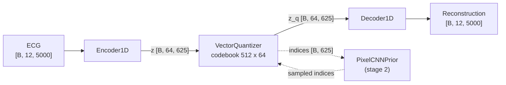

# VQ-VAE + PixelCNN Prior

ECGEN's VQ-VAE is a two-stage generative model for 12-lead ECGs:

1. **Stage 1 – VQ-VAE** (`VQVAELightning`): a 1D convolutional autoencoder whose
   latent is snapped to the nearest entry of a learned codebook, so each ECG becomes a
   sequence of discrete code indices.
2. **Stage 2 – PixelCNN prior** (`PriorLightning`): an autoregressive model over those
   code indices, trained while the stage-1 model stays frozen.

To generate, the prior samples a sequence of code indices and the VQ-VAE decoder turns
it into an ECG.

All classes live in `models/vqvae/` and are exported from `models.vqvae`:

```python
from models.vqvae import (
    VQVAEConfig, PriorConfig,            # dataclass configs
    VQVAE1D, VectorQuantizer,            # plain nn.Modules (stage 1)
    PixelCNNPrior, GatedMaskedConv1d,    # plain nn.Modules (stage 2)
    VQVAELightning, PriorLightning,      # LightningModule wrappers
)
```

For training instructions, see [VQ-VAE Training](../training/vqvae_training.md). For the
generated API reference, see [Models API](../api/models.md).

## Architecture



### Encoder and decoder

`VQVAE1D` reuses the shared `Encoder1D` / `Decoder1D` from `models/components/`, the same
blocks that the [VAE](vae.md) uses:

- **`ResidualBlock1D`** (`models/components/blocks.py`): two `Conv1d(k=3)` → `GroupNorm(8)` → SiLU
  layers with a residual shortcut (a 1×1 conv when the channel count changes).
- **`Encoder1D`**: `Conv1d(k=7)` stem, then for each entry in `channel_multipliers`, `num_res_blocks`
  residual blocks at `base_channels * mult` channels. A stride-2 `Conv1d(k=4)` follows every
  stage except the last. Then two mid residual blocks, GroupNorm, SiLU, and a `Conv1d` to
  `2 * latent_channels`, which is split into `(mean, logvar)`.
- **`Decoder1D`**: the mirror image. It uses `ConvTranspose1d(k=4, stride=2)` upsampling and a
  `Conv1d(k=7)` output to `in_channels` leads.

!!! note "Only the first half of the encoder output is used"
    `Encoder1D` was written for the VAE and returns `(mean, logvar)`. `VQVAE1D.encode()` keeps
    only `mean` as the continuous latent `z` and discards `logvar`. It returns `(z, z)` so the
    API matches the VAE's.

### Vector quantizer

`VectorQuantizer(num_embeddings, embedding_dim, commitment_cost)` (`models/vqvae/vector_quantizer.py`)
works as follows:

- It holds an `nn.Embedding(num_embeddings, embedding_dim)` codebook, initialised uniformly in
  `[-1/K, 1/K]`.
- It finds the nearest codebook vector (L2 distance) for every latent time step.
- It computes `vq_loss = mse(sg[z_q], z) + commitment_cost * mse(z_q, sg[z])`, where `sg` is
  stop-gradient. In this formula the first term updates the encoder and the second term updates
  the codebook. The original VQ-VAE paper does the opposite: it puts β on the encoder
  (commitment) term. Here β = `commitment_cost` scales the codebook term, even though the code
  comments call it the commitment loss.
- It passes gradients to the encoder with the straight-through estimator: `z_q = z + (z_q - z).detach()`.
- `forward(z)` returns `(vq_loss, quantized [B, C, L], indices [B, L])`.
- `get_codebook_entry(indices)` maps `[B, L]` indices back to `[B, C, L]` vectors.

`embedding_dim` is set to `latent_channels`.

### PixelCNN prior

`PixelCNNPrior(num_embeddings, hidden_dim, num_layers)` (`models/vqvae/pixelcnn_prior.py`) has
these parts:

- `nn.Embedding(num_embeddings, hidden_dim)` turns code indices into vectors.
- One `GatedMaskedConv1d` layer with mask **A**, followed by `num_layers - 1` layers with mask **B**.
  All use kernel size 3 and the gated activation `tanh(W_f * x) * sigmoid(W_g * x)`. Mask A hides
  the current and future positions. Mask B hides only future positions.
- A 1×1 `Conv1d` maps `hidden_dim` to `num_embeddings` logits.
- `forward(indices [B, L])` returns `logits [B, num_embeddings, L]`.
- `sample(batch_size=1, latent_length=312, temperature=1.0, device="cuda")` fills a zero tensor
  one position at a time, drawing each code from `softmax(logits / temperature)`.

!!! note "Small receptive field"
    With kernel size 3 and the default `num_layers=3`, each output position sees only the
    3 preceding codes, which is 24 ECG samples or 48 ms at 500 Hz. The prior cannot model
    long-range structure such as consecutive beats unless you increase `num_layers`.

## Shapes and downsampling factor

The encoder has `len(channel_multipliers)` stages, but only the first `len - 1` stages
downsample. Each stride-2 conv halves the length, so:

```
downsampling factor = 2 ** (len(channel_multipliers) - 1)
```

With the default `(1, 2, 4, 4)` the factor is **8**, which gives these shapes:

| Tensor | Shape (defaults, `seq_length=5000`) |
|---|---|
| Input ECG | `[B, 12, 5000]` |
| Continuous latent `z` | `[B, 64, 625]` |
| Quantized latent `z_q` | `[B, 64, 625]` |
| Code indices | `[B, 625]` (values in `[0, 512)`) |
| Prior logits | `[B, 512, 625]` |
| Reconstruction | `[B, 12, 5000]` |

`seq_length` should be divisible by the factor, or the reconstruction will be shorter than
the input.

!!! warning "`PriorLightning.sample()` assumes a factor of 16"
    `PriorLightning.sample()` computes `latent_length = seq_length // 16`, which is 312 for
    5000 samples. The model actually downsamples by 8, so the decoder returns
    `[B, 12, 2496]` rather than `[B, 12, 5000]`. `VQVAELightning.sample()` uses the correct
    formula. Until this is fixed, call `PixelCNNPrior.sample()` with
    `latent_length = seq_length // 8`, as in the [sampling example](#sampling-example) below.
    The `[B, 312]` shapes in `models/vqvae/README.md` and `VQVAE_IMPLEMENTATION.md` come from
    the same mistake.

With the default config, the stage-1 model has about 6.38 M parameters and the PixelCNN prior
has about 0.43 M.

## Configuration

Both configs are dataclasses in `models/vqvae/config.py`. The Lightning wrappers accept either
the dataclass or a plain `dict`, which is converted with `Config(**dict)`.

### `VQVAEConfig`

| Field | Type | Default | Meaning |
|---|---|---|---|
| `in_channels` | `int` | `12` | Number of ECG leads (input and output channels) |
| `base_channels` | `int` | `64` | Channel width of the first encoder stage |
| `latent_channels` | `int` | `64` | Latent channels, which is also the codebook embedding dim |
| `channel_multipliers` | `tuple[int, ...]` | `(1, 2, 4, 4)` | Per-stage width multipliers. `len - 1` sets the number of ×2 downsamplings |
| `num_res_blocks` | `int` | `2` | Residual blocks per stage |
| `num_embeddings` | `int` | `512` | Codebook size `K` |
| `commitment_cost` | `float` | `0.25` | Weight β in the VQ loss |
| `lr` | `float` | `1e-4` | Adam learning rate |
| `b1` | `float` | `0.9` | Adam β1 |
| `b2` | `float` | `0.999` | Adam β2 |

### `PriorConfig`

| Field | Type | Default | Meaning |
|---|---|---|---|
| `num_embeddings` | `int` | `512` | Vocabulary size. **Must equal the VQ-VAE's `num_embeddings`** |
| `hidden_dim` | `int` | `128` | Embedding and conv width of the PixelCNN |
| `num_layers` | `int` | `3` | Number of gated masked conv layers (1 × mask A + `num_layers-1` × mask B) |
| `lr` | `float` | `1e-3` | Adam learning rate |
| `b1` | `float` | `0.9` | Adam β1 |
| `b2` | `float` | `0.999` | Adam β2 |
| `vqvae_checkpoint` | `str` | `""` | Path to the stage-1 checkpoint. If non-empty, it is loaded and frozen in `__init__` |

`configs/model/vqvae/vqvae_1d_base.yaml` and `configs/model/vqvae/prior_base.yaml` list the
same defaults as YAML fragments. See [VQ-VAE Training](../training/vqvae_training.md#configuration)
for how the experiment YAMLs are wired.

## Losses

Both losses live in `training/losses/vqvae_losses.py`.

| Function | Signature | Computes |
|---|---|---|
| `vqvae_loss` | `(recon, x, vq_loss) -> (total, recon_loss, vq_loss)` | `recon_loss = mse(recon, x)` (mean). `total = recon_loss + vq_loss`. There is no KL term |
| `prior_loss` | `(logits [B, K, L], targets [B, L]) -> loss` | Mean cross-entropy over all positions |

`vq_loss` is the codebook + commitment loss returned by `VectorQuantizer`. The total loss has
no extra weight on it.

## Lightning wrappers

### `VQVAELightning` (stage 1)

`models/vqvae/vqvae_lightning.py`. Constructed as `VQVAELightning(config)` and wraps a
`VQVAE1D` in `self.vqvae`.

| Method | Description |
|---|---|
| `forward(x)` | Returns `(recon, vq_loss, indices)` |
| `training_step` / `validation_step` | Accept a `(ecg, features)` tuple (the MIMIC dataset format) or a dict with key `"ecg_signals"` |
| `reconstruct(x)` | `no_grad`. Returns the reconstruction `[B, C, L]` |
| `encode_to_indices(x)` | `no_grad`. Returns code indices `[B, L_latent]`. The prior uses this |
| `decode_from_indices(indices)` | `no_grad`. Returns an ECG `[B, C, L_latent * factor]` |
| `sample(n_samples=16, seq_length=5000)` | Decodes **uniformly random** code indices. Useful only as a sanity check. Use the prior for real generation |
| `configure_optimizers()` | Single Adam optimizer (`lr`, `betas=(b1, b2)`) |

`reconstruct`, `encode_to_indices`, `decode_from_indices` and `sample` put the inner model in
`eval()` mode.

Logged metrics:

| Key | When |
|---|---|
| `train/total_loss`, `train/recon_loss`, `train/vq_loss` | Every step and epoch |
| `train/unique_codes`, `train/codebook_usage` | Every 100th training batch. `codebook_usage = unique_codes / num_embeddings` |
| `val/total_loss`, `val/recon_loss`, `val/vq_loss` | Per epoch |
| `val_loss` | Per epoch (same as `val/total_loss`). Monitored by checkpointing and early stopping |
| `val/unique_codes`, `val/codebook_usage` | Per epoch |

!!! tip "Watch codebook usage"
    A low `codebook_usage` means codebook collapse: only a few codes are ever selected. That
    limits reconstruction quality and makes the prior's job trivial.

### `PriorLightning` (stage 2)

`models/vqvae/prior_lightning.py`. Constructed as `PriorLightning(config)` and wraps a
`PixelCNNPrior` in `self.prior`. If `config.vqvae_checkpoint` is non-empty, `__init__` loads it
with `VQVAELightning.load_from_checkpoint`, calls `.eval()` and `.freeze()`, and stores it in
`self.vqvae`. It raises `FileNotFoundError` if the path does not exist.

| Method | Description |
|---|---|
| `forward(indices)` | Returns the prior logits `[B, K, L]` |
| `training_step` / `validation_step` | Encode the batch with the frozen VQ-VAE (`encode_to_indices`), then apply `prior_loss(logits[:, :, :-1], indices[:, 1:])`. Raise `RuntimeError` if no VQ-VAE is loaded |
| `sample(n_samples=16, seq_length=5000, temperature=1.0)` | Samples indices from the prior and decodes them with the VQ-VAE. See the factor-16 warning above |
| `configure_optimizers()` | Adam over `self.prior` parameters only |

Logged metrics: `train/loss` (per step and epoch), and `val/loss` and `val_loss` (per epoch).

Because `self.vqvae` is a registered submodule, the frozen VQ-VAE weights are saved inside
every prior checkpoint, under keys `vqvae.vqvae.*`.

!!! warning "Training and sampling are off by one"
    Because of mask A, the logit at position `t` depends only on codes `< t`. `PixelCNNPrior.sample()`
    uses it that way: it draws code `t` from logit `t`. `PriorLightning` additionally shifts the
    targets, `logits[:, :, :-1]` vs `indices[:, 1:]`, so during training logit `t` learns to predict
    code `t + 1` without seeing code `t`. Sampling therefore uses each logit for a different position
    than the one it was trained on. If you change the prior, remove one of the two shifts.

## Loading checkpoints

!!! warning "`load_from_checkpoint` needs an explicit `config`"
    Both wrappers call `self.save_hyperparameters(config.__dict__)`. That stores the config fields
    as flat hyperparameters, and Lightning cannot map them back onto the single `config` argument.
    As a result, `VQVAELightning.load_from_checkpoint(path)` raises
    `TypeError: __init__() missing 1 required positional argument: 'config'`.
    `PriorLightning` makes this call internally, so stage-2 training fails in the same way.

    Pass the config explicitly instead:

    ```python
    import torch
    from models.vqvae import VQVAELightning, VQVAEConfig

    hp = torch.load(path, map_location="cpu")["hyper_parameters"]
    vqvae = VQVAELightning.load_from_checkpoint(
        path, map_location="cpu", config=VQVAEConfig(**hp)
    )
    ```

## Usage

### Reconstruction and code extraction

```python
import torch
from models.vqvae import VQVAELightning, VQVAEConfig

ckpt_path = "runs/vqvae_mimic/seed_42/checkpoints/last.ckpt"
hp = torch.load(ckpt_path, map_location="cpu")["hyper_parameters"]
vqvae = VQVAELightning.load_from_checkpoint(
    ckpt_path, map_location="cpu", config=VQVAEConfig(**hp)
).eval()

x = torch.randn(4, 12, 5000)                 # [B, leads, samples]
recon = vqvae.reconstruct(x)                 # [4, 12, 5000]
indices = vqvae.encode_to_indices(x)         # [4, 625], dtype long
x_hat = vqvae.decode_from_indices(indices)   # [4, 12, 5000]
```

### Sampling example

This example works around both issues described above. It rebuilds the modules from the raw
checkpoint dicts and calls the PixelCNN sampler with the correct latent length.

```python
import torch
from models.vqvae import VQVAELightning, VQVAEConfig, PriorLightning, PriorConfig

device = "cuda" if torch.cuda.is_available() else "cpu"


def load_vqvae(path: str) -> VQVAELightning:
    ckpt = torch.load(path, map_location=device)
    model = VQVAELightning(VQVAEConfig(**ckpt["hyper_parameters"]))
    model.load_state_dict(ckpt["state_dict"])
    return model.to(device).eval()


def load_prior(path: str, vqvae: VQVAELightning) -> PriorLightning:
    ckpt = torch.load(path, map_location=device)
    # Don't re-load the VQ-VAE from the path stored in the hparams
    hparams = {**ckpt["hyper_parameters"], "vqvae_checkpoint": ""}
    prior = PriorLightning(PriorConfig(**hparams))
    prior.vqvae = vqvae                       # prior ckpt also contains vqvae.* weights
    prior.load_state_dict(ckpt["state_dict"])
    prior.vqvae.freeze()
    return prior.to(device).eval()


vqvae = load_vqvae("runs/vqvae_mimic/seed_42/checkpoints/last.ckpt")
prior = load_prior("runs/prior_mimic/seed_42/checkpoints/last.ckpt", vqvae)

seq_length = 5000
factor = 2 ** (len(vqvae.config.channel_multipliers) - 1)    # 8 for (1, 2, 4, 4)

indices = prior.prior.sample(
    batch_size=16,
    latent_length=seq_length // factor,   # 625
    temperature=1.0,                      # >1 more diverse, <1 more conservative
    device=device,
)                                         # [16, 625]
ecgs = vqvae.decode_from_indices(indices) # [16, 12, 5000]
```

Sampling is sequential over the 625 latent positions. Each step runs a full forward pass of the
prior, so expect it to be slow on CPU.

## Related

- [VQ-VAE Training](../training/vqvae_training.md): how to train stages 1 and 2
- [VAE](vae.md): the continuous-latent counterpart that shares the encoder and decoder
- [Architecture Overview](architecture.md)
- [Models API](../api/models.md)
